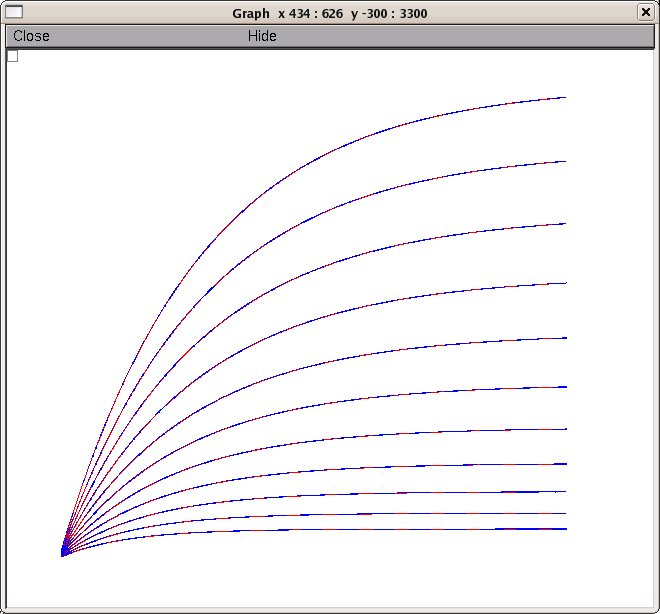
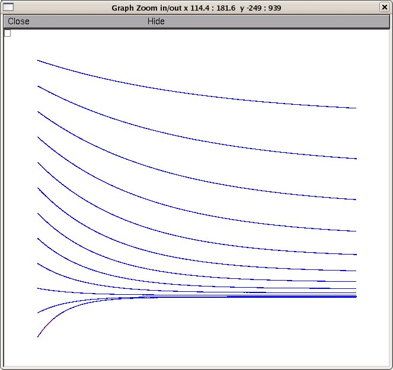

# ModelDB Readme for Model Associated with the Paper

Gurkiewicz M, Korngreen A (2007) A Numerical Approach to Ion Channel Modelling Using Whole-Cell Voltage-Clamp Recordings and a Genetic Algorithm
*PLoS Computational Biology* 3(8):e169

Both the model (569 KB ZIP)
[https://doi.org/10.1371/journal.pcbi.0030169.sd001](https://doi.org/10.1371/journal.pcbi.0030169.sd001)

and the paper
[http://dx.doi.org/10.1371/journal.pcbi.0030169](http://dx.doi.org/10.1371/journal.pcbi.0030169)

are available at the PLoS website, and there is a copy of the model also at [ModelDB accession number 97756](http://senselab.med.yale.edu/ModelDB/showmodel.asp?model=97756).

# Instructions to Run the GA

You have to install a recent version of NEURON available from [http://www.neuron.yale.edu](http://www.neuron.yale.edu).

Once installed, you can auto-launch from ModelDB and start the training algorithm (button press) or:

## Under Linux

Compile the KChannel.mod file using `nrnivmodl` then type:

```
nrngui mosinit.hoc
```

## Under Windows

Run `mknrndll` then double click on the mosinit.hoc file icon.

## Under Mac OS X

On the Mac drag and drop the Ga_demo folder onto the mknrndll icon.
Then drag and drop the mosinit.hoc file onto the nrngui icon.

---

When the simulation starts a window with button choices will appear.

- You can graph the performance of the best individual in the initial starting population by clicking on the **"Show best individual from initial population"** button.
- Click on the button labeled **"Show result of GA"** to see a result of evolution of the model through 600 populations in the GA.
- Clicking on **"Show final result of GA+praxis"** shows how the praxis method built into NEURON refined the GA result.

To run the entire demonstration training session click the **"Start training"** button. When complete (after about 2 hours on a PC) you will see matches for activation (the blue target curves are on top of the red search results):



and deactivation



---

2025-05-30: Standardized to Markdown